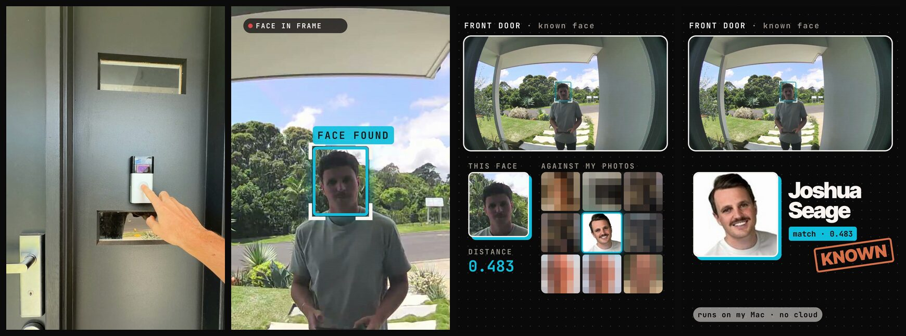
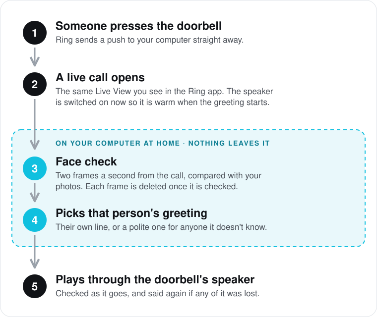
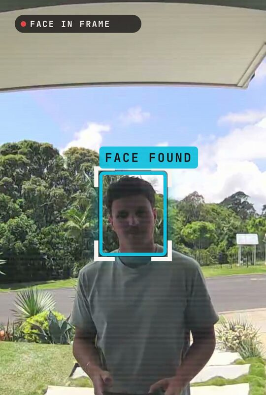
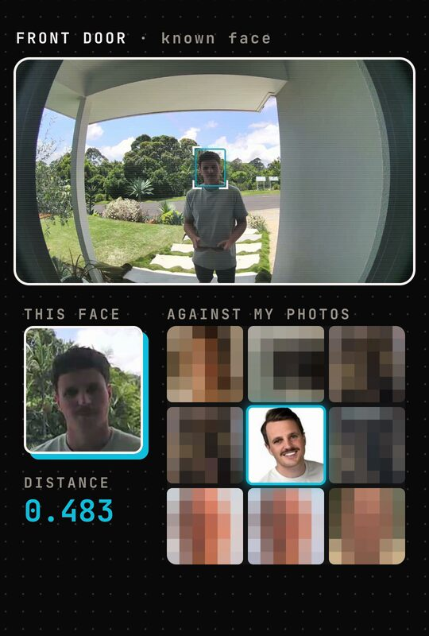

# agentic-doorbell

Your Ring doorbell greets the people you know, by name, in a voice you choose. The face check runs
on your own computer, so nobody's face goes to the cloud. Open source (MIT). Built with Claude.

**New: Eufy.** Eufy video doorbells now have their own option too. It is built but not yet tested on
a real Eufy doorbell, so read [Eufy](#eufy-new-not-tested-yet) first.



Someone presses the doorbell. A moment later the doorbell's own speaker says something just for
them: "Sam! You made it. Be right with you." Anyone it doesn't know gets a polite greeting
of your choosing instead.

## How it works



1. **Someone presses the doorbell.** Ring tells your computer straight away, the same way it tells
   your phone.
2. **A live call opens**, just like tapping Live View in the Ring app. The doorbell's speaker is
   switched on at once, so it is warmed up by the time there is something to say.
3. **Face check, on your computer.** It reads two frames a second from the call and compares the
   face with the photos you gave it. Each frame is deleted as soon as it is checked.
4. **It picks that person's greeting**, or the stranger greeting if no one matches.
5. **The greeting plays through the doorbell's speaker.** A checker counts every bit of sound that
   went out. If any of it was lost, it says the whole greeting again.

| Face found on the live view | Checked against your photos | A match |
|---|---|---|
|  |  |  |

Motion helps too: when someone walks up, it already starts looking, so when they press the button
it often knows who they are and can answer as soon as the doorbell is awake. Motion never talks on
its own.

**Your faces stay on your computer.** The photos, the face index and every frame it checks live in
the `data/` folder on the computer running it. Nothing is uploaded anywhere. No AI service is
called when someone is at the door: the greetings are made ahead of time and kept as sound files.

## What doorbells it works with

| | Doorbells |
|---|---|
| **Tested** | **Ring Video Doorbell (2nd Gen)**, the battery one. Ring's device type for it is `cocoa_doorbell`. Tested in November 2026. |
| **Should work, not tested** | Other Ring video doorbells that have Live View and two-way talk in the Ring app, wired or battery. For example: Battery Doorbell Plus and Pro, Video Doorbell 3, 3 Plus and 4, Doorbell Wired, Doorbell Pro and Pro 2, Doorbell Elite. |
| **Built, not tested yet** | **Eufy** video doorbells with two-way talk. See [Eufy](#eufy-new-not-tested-yet). |
| **Won't work** | Nest, Arlo, Google, Aqara or any other brand. Ring security cameras (no button to press). Any Ring doorbell with **End-to-End Encryption** switched on in the Ring app: Live View from outside the Ring app is not possible then. |

Why "should work": this is built on [ring-client-api](https://github.com/dgreif/ring), the
unofficial Ring library behind the popular Homebridge Ring plugin. It knows every Ring doorbell
above and opens their live calls the same way. Two honest caveats:

- **Battery doorbells take a few seconds to wake** before they can stream or talk. Wired ones
  answer faster.
- **The sound sent to the doorbell** (Opus, mono, 16 kHz, in 60 ms pieces) is what the tested
  doorbell sends itself. If a different model plays greetings too fast, buzzy or cut short, run
  `node probe-audio.mjs` (Troubleshooting) and open an issue with what it prints.

Ring doesn't offer an official way to do this. Because the library is unofficial, a change on
Ring's side could stop it working until the library catches up.

If you run it on another Ring doorbell, please open an issue saying how it went, and we'll add it
to the table.

## Eufy (new, not tested yet)

Eufy doorbells work the same way: a press opens the live view, your computer checks the face, and
the greeting plays through the doorbell's own speaker (Eufy calls it talkback). It is built on
[eufy-security-client](https://github.com/bropat/eufy-security-client), the free library made by
the community that the Homebridge and Home Assistant Eufy plugins use. Not made by Eufy.

**To be straight about it:** this part was written against that library's code and tested against
a stand-in doorbell, not a real one. Nobody has heard a greeting come out of a Eufy doorbell with
it yet. If you try it, please open an issue saying how it went.

**Which Eufy doorbells.** The library's change notes name the Video Doorbell Dual (T8213, T8203),
the wired 2K (T8200X), the battery 2K (T8210, usually with a HomeBase), the E340 (T8214) and the
C30, C31, C33 and E330. Talkback is the part most likely to differ between models.

**Why this library.** Its README now points to a newer project,
[eufy-sdk](https://github.com/mega-yfue/eufy-sdk). We stayed with eufy-security-client for now: it
is the one the Homebridge and Home Assistant plugins have used for years, while eufy-sdk is a few
months old, has a different API and does not yet say which doorbells it supports. If it matures,
moving over is a small change in `eufy.mjs` and `eufy-client.mjs`.

**What's different from Ring:**

- **A second Eufy account.** In the Eufy app, share the doorbell with a second email address you
  own and give it admin rights. Sign in here with that account. Signing in with your main account
  can log your phone out of the Eufy app.
- **The password is saved.** Eufy's library needs the password every time it starts, so it is kept
  in `data/eufy-login.json`, readable by your user only. That is why it should be the second
  account, not your main one.
- **Node 24 or newer.** The Eufy library needs it (Ring needs 22).
- **It can be slower.** Eufy live views can take several seconds to start, more on battery
  doorbells. Motion opens the live view early, so a press a moment later can answer sooner.
- **The greeting's sound** goes out as AAC, mono, 16 kHz, 20 kbps, one frame every 64 ms. That is
  the format thieren found when adding talkback to the library, tested on a battery 2K doorbell.
  Eufy does not document it. If the greeting stutters, set `"eufyStereo": true` (one wired
  doorbell only played cleanly in stereo), and open an issue with your model.
- **Film mode** keeps the video only, not the doorbell's sound.

**Set it up.** Do the normal steps, with these two changes:

1. In `config.json`, set `"brand": "eufy"` and put your doorbell's name from the Eufy app in
   `"camera"`.
2. In step 3, sign in with this instead of `node login.mjs`:

```bash
node eufy-login.mjs
```

Type the second account's email, password and country. Eufy may email a code or show a picture
check: type it in the page. Then run `node check.mjs` and you should see your doorbell under
**Eufy**. Everything else (people, greetings, `--test`, keeping it running) is the same.

## Setting it up with an AI agent

Open this folder in Claude Code (or any coding agent) and say **"set this up"**. It reads
[AGENTS.md](AGENTS.md), runs the checks, and walks you through the same steps as below. It never
signs in to Ring for you (you type your own password and code) and never adds anyone's face
without asking you first.

## What you need

- **A Ring video doorbell** from the table above, with Live View working in the Ring app.
- **A computer that stays on at home**, on the internet all the time:
  - a Mac with Apple silicon (M1 or newer) on macOS 14 or newer, or
  - a 64-bit Linux computer (a Raspberry Pi 4 or 5 with 64-bit Raspberry Pi OS should work; not
    tested yet).

  An Intel Mac needs one change: the ready-built face library has no Intel version, so in
  `requirements.txt` swap `dlib-bin==20.0.1.post1` for `dlib` and run `brew install cmake` first.
  It then builds the library itself, which takes a while.
- **Node.js 22 or newer.** Check with `node --version`. Get it from [nodejs.org](https://nodejs.org)
  or `brew install node`. On Node 25 or newer, npm warns "Unsupported engine" for ring-client-api.
  That warning is harmless: it runs fine on Node 26.
- **Python 3.10 or newer.** Check with `python3 --version`. Mac: `brew install python@3.12`.
  Linux: `sudo apt install python3 python3-venv`.
- **ffmpeg.** Mac: `brew install ffmpeg`. Linux: `sudo apt install ffmpeg`.
- **Your Ring email and password**, and your phone for Ring's sign-in code.
- **Photos of each person** you want greeted: 5 to 15 each, one face per photo.
- **Optional:** an [ElevenLabs](https://elevenlabs.io) account, if you want greetings in a cloned
  or studio voice rather than your own recording or the computer's voice.

No Homebrew on your Mac? Install it first from [brew.sh](https://brew.sh).

## Set it up, step by step

Every step is one command or one thing to do. Run the commands in Terminal (Mac) or a terminal
window (Linux).

### 1. Get the code

```bash
git clone https://github.com/Seagey/agentic-doorbell.git ~/agentic-doorbell
cd ~/agentic-doorbell
```

You should see a new `agentic-doorbell` folder in your home folder.

Keep it in your home folder. On a Mac, don't put it in Desktop, Documents or Downloads: macOS stops
background services reading those folders, so step 9 would fail.

### 2. Install

```bash
./setup.sh
```

This installs the Node packages, makes a Python environment for face matching (`.venv`), and makes
your own `config.json` and `lines.json` from the examples. It takes a few minutes the first time.
At the end you should see `Installed. Next: README step 3`. A list of `FIX` lines above that is
normal at this point: they are the steps still to come.

### 3. Sign in to Ring (once)

```bash
node login.mjs
```

It prints a link. Open it on this computer, type your Ring email and password, then the code Ring
texts or emails you. You should see **Signed in**, and the command stops by itself.

Signing in from your phone is easier if the computer has no screen: run `node login.mjs --lan`
instead and open the second link it prints on your phone (same Wi-Fi). Your password goes only to
Ring and is never saved. Only Ring's sign-in token is kept, in `data/ring-token.json`, readable by
your user only. In the Ring app's Control Center it shows up as a client device called
**agentic-doorbell**.

Then check it can see your doorbell:

```bash
node check.mjs
```

You should see your doorbell listed under **Ring**, for example `Front Door | cocoa_doorbell |
doorbell yes | battery 89`. If yours isn't called **Front Door**, put its name in `config.json` as
`"camera"`. `FIX` lines about people and greetings are the next steps, so leave them for now.

### 4. Add the people

Make a folder for each person inside `data/faces/`, named the way you want it in the log, and put
**5 to 15 photos** of them in it:

```
data/faces/
  Sam/     01.jpg  02.jpg  03.jpg ...
  Alex/    01.jpg  02.jpg ...
```

- **One face per photo.** Photos with two or more faces are skipped, because it can't tell whose
  face is whose. Crop group photos down to just that person.
- **Clear and mostly front-on**, in different light and on different days. A few taken at your
  own door, at the doorbell's height, help most of all.
- **JPG or PNG.** iPhone photos are often HEIC: export them as JPEG first (in Photos: File, Export).

**Ask each person first** (see Privacy and consent).

**Optional, Mac only: copy them from the Photos app.** If you have named people in Photos (the
People album), this copies up to 15 face crops each:

```bash
.venv/bin/python export_faces.py --list
.venv/bin/python export_faces.py "Sam" "Alex"
```

The first command lists the people you have named and how many faces each has. The second copies
their crops into `data/faces/`. Look through the crops and delete any of the wrong person. Your
Terminal app needs Full Disk Access to read the Photos library (System Settings, Privacy &
Security, Full Disk Access).

### 5. Build the face index

```bash
.venv/bin/python match.py --build
```

You should see something like `{"people": ["Alex", "Sam"], "photos": 23}`. Run it again whenever
you add, change or remove photos.

Optional: see how well it tells your people apart.

```bash
.venv/bin/python face_test.py
```

You want `wrong 0`. A few `nobody` are fine.

### 6. Make each greeting

Open `lines.json` and write one greeting per person. The names must match the folder names in
`data/faces/` exactly. `_stranger` is for anyone it doesn't know.

```json
{
  "Sam": "Sam! You made it. Be right with you.",
  "Alex": "Alex, hello again. We'll be right there.",
  "_stranger": "Hello, thanks for coming. One moment please. Deliveries can go by the door."
}
```

Short and slow works best through a small doorbell speaker. Then pick a voice. You can mix them:
each person's greeting is just a sound file in `data/lines/<name>/`.

**Your own voice** (what the person who built this uses for his own greeting). Record it on your
phone, then put the file (m4a, mp3 or wav) into that person's folder, for example
`data/lines/Sam/hello.m4a`. Make the folder if it isn't there. Speak slowly and leave a breath
between sentences. Put two or more files in one folder and it picks one at random each time.

**The computer's voice** (free, nothing to sign up for):

```bash
node voice.mjs --computer
```

**ElevenLabs** (a studio voice, or a clone of your own voice). Make a file called `.env` in this
folder with your key, `ELEVENLABS_API_KEY=your-key-here`, then put the voice's name in
`config.json`: `"elevenlabs": { "voice": "Your voice name", "speed": 0.7 }`. Then:

```bash
node voice.mjs --elevenlabs
```

Each greeting uses about one ElevenLabs character per letter, so a dozen greetings cost a few
hundred. To see what it will make before it makes anything, add `--dry-run`. It skips people who
already have a sound file; `node voice.mjs Sam` remakes just Sam's.

You should see `saved data/lines/Sam/line.wav` (or `.mp3`) for each greeting.

### 7. Test it

```bash
node greeter.mjs --test Sam
```

The doorbell wakes (a few seconds on a battery doorbell) and says Sam's greeting. You should see
`spoke Sam 86/86 packets in 5.0 s ok` (the numbers depend on the length), then `test played`.
`--test _stranger` plays the stranger greeting.

Then a real test: run `node greeter.mjs` and walk up to the door yourself (with your own face in
`data/faces/`).


### 8. Run it

```bash
node greeter.mjs
```

You should see `watching Front Door (cocoa_doorbell, battery 89)`. Leave it running. Each visit
adds lines like these:

```
push: com.ring.pn.live-event.motion
motion: Sam faces 1 distance 0.41 2.6 s
push: com.ring.pn.live-event.ding
ding: Sam faces 1 distance - 0.4 s seen on motion
spoke Sam 86/86 packets in 5.0 s ok
```

`faces` is how many faces it saw, `distance` how close the best match was (lower is closer, 0.5
or under is a match) and the seconds how long it took. Press Ctrl+C to stop it.

**Only run one copy at a time.** Two programs using one Ring sign-in knock each other out. Stop the
background service (step 9) before you run `--test`, `check.mjs` or `probe-audio.mjs`.

### 9. Keep it running

So it starts by itself after a restart and comes back if it ever stops.

**Mac (launchd):**

1. Open `service/agentic-doorbell.plist` in a text editor and replace each `FOLDER` with the full
   path to this folder. To see it, run `pwd` in the folder and copy what it prints.
2. Then:

   ```bash
   cp service/agentic-doorbell.plist ~/Library/LaunchAgents/
   launchctl bootstrap gui/$(id -u) ~/Library/LaunchAgents/agentic-doorbell.plist
   ```

3. Watch it with `tail -f greeter.log`. You should see the `watching` line.

To stop it: `launchctl bootout gui/$(id -u)/agentic-doorbell`. Also stop the Mac sleeping: System
Settings, Energy (or Battery, Options on a laptop), turn on "Prevent automatic sleeping when the
display is off".

**Linux (systemd):** edit `service/agentic-doorbell.service` the same way (FOLDER and USER), then
`sudo cp service/agentic-doorbell.service /etc/systemd/system/` and
`sudo systemctl enable --now agentic-doorbell`. Watch it with `journalctl -u agentic-doorbell -f`.

**Or pm2**, on either: `npm install -g pm2`, then `pm2 start greeter.mjs --name agentic-doorbell`,
`pm2 save`, and `pm2 startup` (it prints one more command to run).

### 10. Optional: film mode

For filming a video of it working. While film mode is on, every live call is recorded into the
`film/` folder as an mp4, with a small note beside it saying who it matched and when the greeting
started (handy in the edit, because the doorbell may cancel its own speaker out of its microphone).

```bash
touch data/film-mode      # on, for 24 hours
rm data/film-mode         # off
```

It switches itself off 24 hours after you turn it on. People named in `"filmPeople"` in
`config.json` (or in the `data/film-mode` file, one name per line) get their whole walk-up filmed:
the recording carries on from motion until they press the button. Empty means everyone it knows.

**Film mode records everyone who comes to the door while it is on**, not just you. Switch it off
when you have your shot, and delete recordings of anyone who didn't agree to be filmed. To check
the picture first: `node greeter.mjs --film-test` records 12 seconds now.

## Settings

All in `config.json`. Leave out anything you don't want to change.

| Setting | Default | What it does |
|---|---|---|
| `brand` | `"ring"` | `"ring"` or `"eufy"`. See [Eufy](#eufy-new-not-tested-yet). |
| `eufyStereo` | `false` | Eufy only: send the greeting in stereo. Try it if the greeting stutters. |
| `camera` | `"Front Door"` | Your doorbell's name in the Ring (or Eufy) app. If no camera has this name, it uses the first doorbell. |
| `threshold` | `0.5` | How close a face must be to count as a match. Lower is stricter. The face library's own default is 0.6; 0.5 suits a fisheye doorbell. |
| `lookOnPressSeconds` | `10` | How long it keeps looking for a known face after a press, before it plays the stranger greeting. |
| `lookOnMotionSeconds` | `15` | How long it looks when someone walks up. |
| `motion` | `true` | Look on motion too, so a press can be answered faster. `false` to only look after a press. |
| `speakerWarmUpSeconds` | `3.5` | The least time between switching the doorbell's speaker on and the greeting starting. |
| `filmPeople` | `[]` | Film mode: whose walk-up to follow from motion to the press. Empty means everyone it knows. |
| `elevenlabs` | `{ "voice": "", "speed": 0.7 }` | ElevenLabs voice name or id, and speed (0.7 is the slowest and clearest). |
| `python`, `ffmpeg`, `ffprobe` | the installed ones | Only if yours live somewhere unusual. |

## Troubleshooting

Start with `node check.mjs` (stop the service first). It says what to fix.

**It gave a known person the stranger greeting, and the log says `faces 0`.** It never found a face.
The usual cause is bright sun behind the person: the camera sets itself for the sky and the face
comes out too dark. It keeps looking for `lookOnPressSeconds`, so a step closer or out of the glare
often fixes it. Shade over the door, or light on the face, fixes it for good.

**It said the stranger greeting, and the log shows a distance just over 0.5** (for example
`distance 0.546`). A near miss: it saw a face but wasn't sure enough. Add a few more photos of that
person, ideally taken at your door at the doorbell's height, and run `match.py --build` again. You
can also raise `threshold` a little (0.55), but run `face_test.py` afterwards and keep `wrong 0`,
or it may start greeting people by the wrong name.

**There's a wait before it speaks.** A battery doorbell needs a few seconds to wake before it can
stream or talk, and the speaker needs its warm-up. The motion look saves time: if it already saw who
walked up, the press is answered as soon as the doorbell is awake (`seen on motion` in the log).
Check motion alerts are on for the doorbell in the Ring app.

**The log shows `ERR_CRYPTO_ECDH_INVALID_PUBLIC_KEY`, and presses do nothing.** Ring's alerts are
not being decoded. The library ships with an older alert reader (`@eneris/push-receiver` 4.3.0)
that misreads some of Ring's alerts; `package.json` forces the fixed version (4.4.0). Check with
`npm ls @eneris/push-receiver`. If it doesn't say 4.4.0, run `rm -rf node_modules` then
`npm install`.

**The start or the end of the greeting is cut off.** The log line `spoke ... PROBLEM: <why>` says
what went wrong, and it will have said the greeting again. If the first word is often lost, raise
`speakerWarmUpSeconds` to 4.5. If your own recording has silence at the start, trim it.

**The greeting sounds fast, buzzy or robotic.** Your doorbell may want sound in a different shape
from the tested one. Run `node probe-audio.mjs` (it plays nothing) and open an issue with what it
prints.

**Nothing happens at all when someone presses.** Check the log for `push:` lines. None at all means
Ring's alerts aren't arriving: check the doorbell's alerts are on in the Ring app, then restart it.
A `late push, skipped` line means an alert arrived over a minute late, so it was ignored on purpose.

**`no doorbell called Front Door`.** Run `node check.mjs` to see your doorbell's real name and put
it in `config.json`.

**It stopped with a sign-in error.** Usually two programs used the Ring sign-in at once (for
example `check.mjs` while the service ran). Run `node login.mjs` again, then start the service.

## Privacy and consent

- **Faces stay on your computer.** Reference photos, the face index and live frames are kept in
  `data/` and never uploaded. Each live frame is deleted as soon as it is checked. A stranger's
  face is never stored (unless film mode is on).
- **Ask people before you add their face.** It is their face, and it is your call to make with them,
  not for them. Take someone out by deleting their folder in `data/faces/` and running
  `match.py --build`.
- **Recording visitors may be regulated where you live.** Some places have rules about filming or
  recording people at your door, about recording sound, or about using face recognition. This is a
  general note, not legal advice: check what applies to you.
- **Film mode keeps every recording while it is on**, of anyone who comes to the door. Switch it off
  after filming, and delete what you don't need.
- **Your Ring sign-in token** is in `data/ring-token.json`. Treat it like a password. `data/`,
  `film/`, `config.json`, `lines.json` and `.env` are all in `.gitignore`, so they never end up in
  git.

## Credits

Built on [ring-client-api](https://github.com/dgreif/ring) by Dusty Greif,
[eufy-security-client](https://github.com/bropat/eufy-security-client) by bropat and others (its
two-way talk was added by [thieren](https://github.com/thieren), whose notes set the greeting's
sound format), and
[face_recognition](https://github.com/ageitgey/face_recognition) by Adam Geitgey (both MIT), which
uses [dlib](http://dlib.net). Not made by or connected with Ring, Amazon or Eufy. MIT licence: see
[LICENSE](LICENSE).
